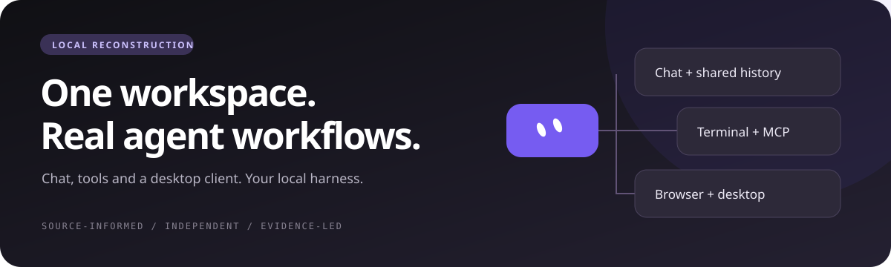
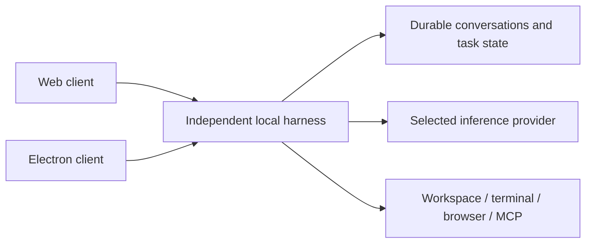

<div align="center">



# Grok Bot reconstruction

**Your agents. Your tools. Your desktop.**

A local-first reconstruction of the Grok Bot experience, with an independent execution harness.

[Quick start](#quick-start) · [Desktop](#desktop) · [Architecture](#how-it-fits-together) · [Evidence](#built-to-be-checked)

</div>

---

## A conversation that can get things done

Chat is the front door. Behind it: queued work, durable task state, an owned browser, a terminal and MCP tools. The web and desktop clients use the same local backend, so paired sessions can share conversations and read status.

| In the workspace | What it does |
| --- | --- |
| **Chat with structure** | Streaming replies, Markdown, code, tables, diagrams, quotes and rich-text drafts. |
| **Work that survives interruption** | Queued messages, scheduled work, cancellation, receipts and recovery after reload. |
| **Tools with visible execution** | Owned browser sessions, workspace files, sandboxed terminal commands and MCP integrations. |
| **Context that travels with the task** | Attachments and versioned private skills selected with `/` or `@`. |
| **One history across local clients** | Cursor pagination, older-message navigation and shared read status for explicitly paired sessions. |
| **A native desktop window** | An Electron client with its own profile, isolated renderer and verified local-backend startup. |

This is an independent, source-informed reconstruction. It does not contain the original private backend, and it is not a claim of 100% parity.

## Quick start

Requires **Node.js 22.13+**. Native terminal execution requires macOS.

```sh
git clone https://github.com/robinbril/grokbot-reconstruction.git
cd grokbot-reconstruction
npm run setup
cp .env.example .env
npm start
```

Open **[127.0.0.1:8876](http://127.0.0.1:8876/)**. The example environment selects this port; without an environment file the default is `8765`.

The interface works without a model key. To execute model-driven tasks, configure one provider privately in `.env`:

| Provider | Configuration | Boundary |
| --- | --- | --- |
| **Direct xAI** | `GROK_MODEL_PROVIDER=xai`, `XAI_API_KEY`, `XAI_MODEL` | Adapter is fixture-tested. Live xAI inference still needs a valid account and verification. |
| **Your Claude seat** | `GROK_MODEL_PROVIDER=claude-seat`, `CLAUDE_MODEL`, an authorized CLI login | CLI supplies inference only. The independent host owns tools, permissions, queue and transcripts. |

No provider fallback. No shared keys. No Codex execution harness in the production composition.

## Existing installations

The applications now live in `apps/web` and `apps/desktop`. Before upgrading an existing installation, set `HARNESS_DATA_DIR` in your ignored root `.env` to the absolute path of its existing private runtime store. Git does not migrate ignored runtime data. Browser storage and device/session protocol names remain unchanged.

## Desktop

After the web setup:

```sh
npm run setup:desktop
npm run desktop
```

The launcher reuses a verified local backend or starts its own. It stops only processes it created. On macOS, closing the last window keeps the application running; reopening restores the window. An owned-backend crash closes its desktop client rather than leaving a disconnected shell.

The renderer has **no Node access, preload bridge or privileged IPC**. The desktop client currently blocks popups, foreign navigation and new OS permissions. Desktop OAuth popups and microphone capture are not implemented. This is a development client, without a signed installer.

[Architecture and verification limits →](docs/ARCHITECTURE.md)

## How it fits together



Model proposals are not execution receipts. The host validates actions, applies approvals, executes tools and records results. External MCP effects require approval unless the configured server declares the tool read-only. Stdio MCP programs remain trusted native programs, not virtual machines.

To share local history, open **Accountmenu → Apparaten**. Generate a single-use code and enter it in a fresh client profile on the same server. Existing server data prevents pairing instead of silently abandoning that data. Pair only clients you control.

| Path | Responsibility |
| --- | --- |
| [`apps/web/`](apps/web/) | Web interface, independent harness, assets and tests. |
| [`apps/desktop/`](apps/desktop/) | Electron window, launcher and lifecycle/security tests. |
| [`docs/`](docs/) | Architecture, setup details and explicit acceptance boundaries. |

[Architecture and verification →](docs/ARCHITECTURE.md)

## Built to be checked

```sh
npm run test:desktop    # Desktop lifecycle and isolation contracts
npm run check:structure # Repository boundaries
npm run verify:model   # Real selected-provider attachment/streaming probe
npm run check:push     # Local repository gate; does not push to GitHub
```

UI recording uses the developer's authorized Claude seat. Replay cache belongs in the repository; credentials and runtime data do not. A saved focused result never substitutes for a full current gate.

The latest complete UI run passed **409/412** cases. Its three failures subsequently passed targeted checks; a new complete green run is still unverified. After the application-directory migration, **883 maintained Node tests**, **26 desktop tests** and **3 fresh browser tests** passed. Root `npm run setup` and actual `npm start` were also verified. The configured Claude test seat requires sign-in before a new model-driven recording run.

Research logs, screenshots and dated acceptance reports are kept in a separate local archive. Required source-reference fixtures remain beside their tests. These are historical source comparisons, not a claim that every native or private-cloud behavior is identical.

## Honest boundaries

- **Original cloud and phone:** local paired clients are proven; the original private service and a physical phone are not.
- **Real accounts:** GitHub needs your own OAuth app, secret and consent. Notion is outside the current acceptance scope.
- **Autonomy:** measured multistep tasks exist; hour/day reliability under production load is not established.
- **Visual parity:** extracted patterns and tested transitions do not prove every pixel or every timing is identical.

Secrets, private chats, runtime stores, dependencies and full extracted application bundles stay outside Git. Third-party assets retain their licenses and provenance. This independent development project is not affiliated with the original vendor.
